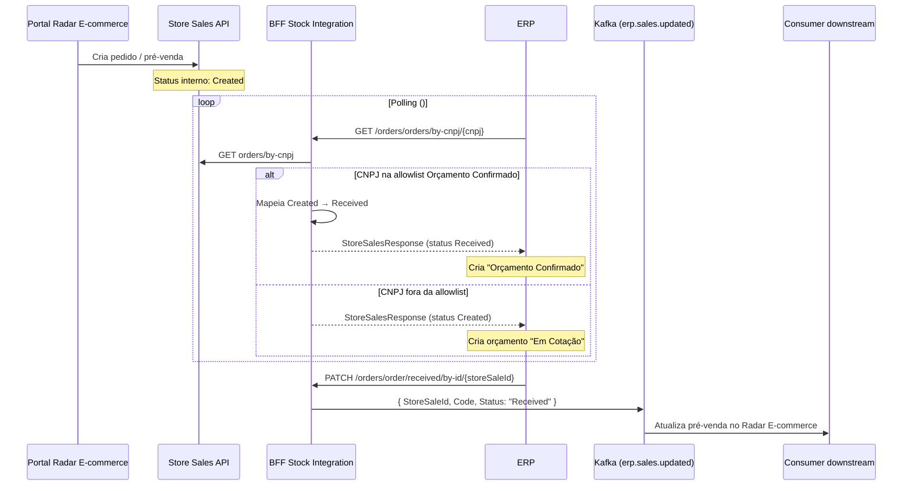

# Documentação Técnica de Integração — ERP × Radar E-commerce

## Fluxo de Pré-vendas (`/orders`)

**Serviço:** `ecomm-bff-stock-file-validator-dotnet` (BFF de integração)  
**Versão da API:** `v1`  
**Base path:** `/marketing/v1/stock/orders/`

---

## Índice

1. [Visão geral](#1-visão-geral)
2. [Arquitetura do fluxo](#2-arquitetura-do-fluxo)
3. [Contexto de pré-venda](#3-contexto-de-pré-venda)
4. [Orçamento Confirmado](#4-orçamento-confirmado)
5. [Ambientes](#5-ambientes)
6. [Autenticação](#6-autenticação)
7. [Rotas da API](#7-rotas-da-api)
8. [Mapeamento de status](#8-mapeamento-de-status)
9. [Modelo de dados](#9-modelo-de-dados)
10. [Eventos Kafka](#10-eventos-kafka)
11. [Tratamento de erros](#11-tratamento-de-erros)
12. [Guia de implementação ](#12-guia-de-implementação)
13. [Requests e responses completos](#13-requests-e-responses-completos)
14. [Variáveis de ambiente](#14-variáveis-de-ambiente)

---

## 1. Visão geral

A integração entre o portal Radar E-commerce e o ERP segue um modelo **pull + callback**:

1. O cliente finaliza um pedido no portal.
2. O serviço **Store Sales** (`order-building`) registra a **pré-venda** com status interno `Created`.
3. O ERP consulta periodicamente o BFF (`GET /orders/orders/by-cnpj/{cnpj}`) para obter as pré-vendas da loja.
4. Para lojas habilitadas no fluxo **Orçamento Confirmado** (ECC-304), o BFF **mapeia `Created` → `Received`** na resposta do polling. O  deve criar o orçamento já como **"Orçamento Confirmado"**.
5. Conforme o pedido avança, o ERP **notifica o BFF** via endpoints `PATCH` de atualização de status e nota fiscal.
6. O BFF publica eventos no Kafka (`erp.sales.updated`) para atualizar o ciclo de vida da pré-venda no Radar E-commerce.

> **Nota:** Toda a integração ERP descrita neste documento utiliza as rotas `/marketing/v1/stock/orders/`, que trafegam o **formato interno** do Radar E-commerce (`StoreSalesResponse`). A consulta retorna todas as pré-vendas do CNPJ; o  filtra por status no seu lado.

---

## 2. Arquitetura do fluxo



---

## 3. Contexto de pré-venda

### 3.1 Criação da pré-venda

A criação do pedido no portal **não passa por este BFF**. Ela ocorre no serviço **Store Sales** (`URL_STORE_SALES`):

```
GET {URL_STORE_SALES}products-sales/v1/store/order-building/orders/by-cnpj/{cnpj}
GET {URL_STORE_SALES}products-sales/v1/store/order-building/order/by-store-sale-id/{id}
GET {URL_STORE_SALES}products-sales/v1/store/order-building/orders/by-cnpj-and-status/{cnpj}/{status}
```

O endpoint `GET /orders/orders/by-cnpj/{cnpj}` do BFF encapsula a consulta ao Store Sales e devolve a lista de pré-vendas no formato `StoreSalesResponse`.

### 3.2 Campos usados na criação do orçamento

| Campo (`StoreSalesResponse`) | Uso no ERP |
|------------------------------|---------------|
| `storeSaleId` | Identificador da pré-venda — chave de idempotência |
| `order.orderId` | ID do pedido no portal |
| `order.number` | Número do pedido |
| `order.status` | Define o tipo de orçamento (ver [seção 4](#4-orçamento-confirmado)) |
| `order.paymentType` | `Online` (já pago) ou `Offline` (pagamento na entrega/retirada) |
| `customer.cpf` | CPF do cliente |
| `items[].ean` | EAN do produto |
| `items[].quantity` | Quantidade |
| `items[].price` | Preço unitário |
| `order.totalAmount` | Valor total do orçamento |

### 3.3 Identificadores de orçamento (retorno na NF)

Na emissão da nota fiscal, o ERP deve informar os campos de vínculo com o orçamento:

| Campo | Descrição |
|-------|-----------|
| `identificacaoOrcamento` | Identificação do orçamento no ERP |
| `integracaoCodigoOrcamento` | Código de integração do orçamento |

---

## 4. Orçamento Confirmado

Feature **ECC-304**: para CNPJs na allowlist, o BFF remapeia o status da pré-venda na resposta do polling para que o ERP crie o orçamento já **confirmado**, sem passar por "Em Cotação".

### 4.1 Comportamento

| Situação | Status no Store Sales | Status retornado pelo BFF | Ação no ERP |
|----------|----------------------|---------------------------|----------------|
| CNPJ **na** allowlist | `Created` | `Received` | Criar **"Orçamento Confirmado"** |
| CNPJ **fora** da allowlist | `Created` | `Created` | Criar orçamento **"Em Cotação"** |
| Qualquer CNPJ | Outros status (`Canceled`, etc.) | Sem alteração | Seguir fluxo normal |

> O mapeamento ocorre **somente na resposta HTTP** do `GET /orders/orders/by-cnpj/{cnpj}`. O status persistido no Store Sales permanece `Created` até o ERP enviar o callback `PATCH /received` (ou outro callback).

### 4.2 Allowlist de CNPJs

A feature é controlada por allowlist. Lista vazia = feature **desligada** para todas as lojas.

| Fonte | Como configurar |
|-------|-----------------|
| `appsettings` | Seção `ERPConfirmedBudget:EnabledCnpjs` (array de CNPJs) |
| Variável de ambiente | `ERP_CONFIRMED_BUDGET_CNPJS` (CSV, ex.: `59487142000178,12345678000199`) |

As duas fontes são **mescladas**. CNPJs são normalizados para apenas dígitos (aceita máscara `59.487.142/0001-78`).

**Exemplo `appsettings`:**

```json
{
  "ERPConfirmedBudget": {
    "EnabledCnpjs": [ "59487142000178" ]
  }
}
```

**Exemplo env:**

```bash
ERP_CONFIRMED_BUDGET_CNPJS=59487142000178,12345678000199
```

### 4.3 Implementação no BFF

| Classe | Papel |
|--------|-------|
| `ERPConfirmedBudgetOptions` | Configuração (`SectionName`, `CnpjsEnvKey`, `EnabledCnpjs`) |
| `ERPConfirmedBudgetStoreFilter` | Decide se o CNPJ está habilitado |
| `OrderService.GetOrdersByCnpj` | Aplica o mapeamento `Created` → `Received` após a consulta ao Store Sales |

### 4.4 Impacto no ciclo de vida

**Com Orçamento Confirmado (CNPJ na allowlist):**

```
Portal cria pré-venda (Created no Store Sales)
        ↓
ERP polling → BFF retorna status "Received"
        ↓
ERP cria "Orçamento Confirmado"
        ↓
ERP PATCH /received → confirma no Radar (Kafka Status: Received)
        ↓
... demais steps (accept / release / invoice / finish)
```

**Sem Orçamento Confirmado (CNPJ fora da allowlist):**

```
Portal cria pré-venda (Created)
        ↓
ERP polling → BFF retorna status "Created"
        ↓
ERP cria orçamento "Em Cotação"
        ↓
ERP PATCH /received → Status "Received" (Confirmado)
        ↓
... demais steps
```

---

## 5. Ambientes

| Ambiente | URL base |
|----------|----------|
| **Staging** | `https://api-stg.radarfarmarcas.com.br` |
| **Produção** | `https://api.radarfarmarcas.com.br` |

---

## 6. Autenticação

| Header | Obrigatório | Descrição |
|--------|-------------|-----------|
| `api-key` | Sim (todos os endpoints) | Chave da loja, validada via Consumer API |

O CNPJ da loja é informado **na própria rota** do `GET /orders/orders/by-cnpj/{cnpj}` — não há header `cnpj` nas rotas `/orders`.

### Validação

1. No `GET /orders/orders/by-cnpj/{cnpj}`, o BFF consulta `{URL_CONSUMER_API_BASE}/consumer-managment/v1/consumer/store/by-cnpj/{cnpj}/keys`
2. Compara a `api-key` recebida com a chave cadastrada
3. Resultado cacheado por **12 horas**
4. Os endpoints `PATCH` (callbacks de status/NF) exigem apenas a presença de `api-key` válida

### Respostas de autenticação

| Código | Significado |
|--------|-------------|
| `401` | `api-key` inválida ou ausente (no `GET /orders/by-cnpj`) |
| `400` | Parâmetros obrigatórios ausentes ou payload inválido |

---

## 7. Rotas da API

Base: `/marketing/v1/stock/orders/`

### 7.1 Consulta de pré-vendas

| Método | Rota | Descrição |
|--------|------|-----------|
| `GET` | `/orders/by-cnpj/{cnpj}` | Lista as pré-vendas da loja (formato `StoreSalesResponse`). Aplica mapeamento Orçamento Confirmado quando o CNPJ está na allowlist. |

### 7.2 Atualização de status (callbacks ERP → BFF)

| Método | Rota | Ação | Status Kafka |
|--------|------|------|--------------|
| `PATCH` | `/order/received/by-id/{storeSaleId}` | Confirma recebimento (body com `presaleCode`) | `Received` |
| `PATCH` | `/order/cancel/by-id/{storeSaleId}` | Cancela por ID | `Canceled` |
| `PATCH` | `/order/cancel/by-presale/{code}` | Cancela por código | `Canceled` |
| `PATCH` | `/order/finish/by-id/{storeSaleId}` | Finaliza por ID | `Finished` |
| `PATCH` | `/order/finish/by-presale/{code}` | Finaliza por código | `Finished` |
| `PATCH` | `/order/accept/by-id/{storeSaleId}` | Aceita (em separação) por ID | `Triage` |
| `PATCH` | `/order/accept/by-presale/{code}` | Aceita por código | `Triage` |
| `PATCH` | `/order/release/by-id/{storeSaleId}` | Libera por ID | `InWaiting` |
| `PATCH` | `/order/release/by-presale/{code}` | Libera por código | `InWaiting` |

### 7.3 Nota fiscal

| Método | Rota | Descrição |
|--------|------|-----------|
| `PATCH` | `/order/invoice/by-id/{storeSaleId}` | Envia NF por ID |
| `PATCH` | `/order/invoice/by-presale/{code}` | Envia NF por código |
| `PATCH` | `/order/wake-invoice/by-presale/{code}` | Envia NF Wake (fluxo separado) |

---

## 8. Mapeamento de status

### 8.1 Status internos da pré-venda (`order.status`)

O `GET /orders/orders/by-cnpj/{cnpj}` retorna o status como **string**. Valores possíveis na resposta:

| Status | Significado | Origem |
|--------|-------------|--------|
| `Created` | Pré-venda nova → criar orçamento **"Em Cotação"** (CNPJ **fora** da allowlist) | Portal (sem mapeamento) |
| `Received` | Pré-venda nova mapeada → criar **"Orçamento Confirmado"** (CNPJ **na** allowlist) **ou** pré-venda já confirmada via callback | BFF (mapeamento) / Callback `received` |
| `Triage` | Em separação | Callback `accept` |
| `InWaiting` | Liberada | Callback `release` |
| `Finished` | Finalizada | Callback `finish` |
| `Canceled` | Cancelada | Callback `cancel` |

### 8.2 Tipo de pagamento (`order.paymentType`)

| Valor | Significado |
|-------|-------------|
| `Online` | Pagamento já capturado no portal (pix, cartão, etc.) |
| `Offline` | Pagamento na entrega ou na retirada (dinheiro, maquininha) |

Para novas pré-vendas:
- **`Online`** → orçamento já quitado
- **`Offline`** → orçamento com pagamento pendente

### 8.3 Filtro no lado do ERP

O endpoint `GET /orders/orders/by-cnpj/{cnpj}` **retorna todas as pré-vendas da loja**. O ERP deve filtrar:

| Fluxo | Critério para importar |
|-------|------------------------|
| **Orçamento Confirmado** (CNPJ na allowlist) | `order.status == "Received"` e `storeSaleId` ainda não processado → criar **"Orçamento Confirmado"** |
| **Em Cotação** (CNPJ fora da allowlist) | `order.status == "Created"` e `storeSaleId` ainda não processado → criar **"Em Cotação"** |

Em ambos os casos, controlar `storeSaleId` já processados para evitar duplicidade.

### 8.4 Ciclo de vida sugerido (Orçamento Confirmado)

```
Portal cria pré-venda (Created no Store Sales)
        ↓
ERP polling (GET by-cnpj) → BFF retorna "Received"
        ↓
ERP cria "Orçamento Confirmado"
        ↓
ERP PATCH /received → confirma no Radar (Kafka: Received)
        ↓
ERP PATCH /accept  → Status "Triage" (Em separação)
        ↓
ERP PATCH /release → Status "InWaiting" (Liberado)
        ↓
ERP PATCH /invoice → NF vinculada ao orçamento
        ↓
ERP PATCH /finish  → Status "Finished" (Finalizado)
```
---

## 9. Modelo de dados

### 9.1 `StoreSalesResponse`

Estrutura retornada pelo `GET /orders/orders/by-cnpj/{cnpj}`:

```
StoreSalesResponse
└── storeSales: StoreSalesDto[]
```

### 9.2 `StoreSalesDto` — campos principais

| Campo | Tipo | Descrição |
|-------|------|-----------|
| `storeSaleId` | string | ID da pré-venda (chave de integração) |
| `lastUpdated` | datetime | Última atualização |
| `createdAt` | datetime | Data de criação |
| `erpInfo.presaleCode` | string | Código da pré-venda no ERP |
| `erpInfo.receivedDate` | datetime | Data de recebimento no ERP |
| `order` | objeto | Dados do pedido (ver 9.3) |
| `customer` | objeto | Dados do cliente (CPF, nome, telefone, e-mail, endereço) |
| `network` | objeto | Rede da loja |
| `store` | objeto | Loja (CNPJ, endereço) |
| `items[]` | lista | Itens (`ean`, `name`, `price`, `quantity`, `id`) |
| `onlinePayment` | objeto | Dados de pagamento online (bandeira, cartão, NSU, parcelas) |

### 9.3 `order`

| Campo | Descrição |
|-------|-----------|
| `orderId` | ID do pedido no portal |
| `number` | Número do pedido |
| `status` | Status interno (ver [8.1](#81-status-internos-da-pré-venda-orderstatus)) |
| `date` | Data do pedido |
| `orderType` | vem do `order.shipping.Name` que pode ser "Entrega em domicilio" ou "Retirada na loja" |
| `itemQuantity` | Quantidade de itens |
| `deliveryOrPickupFee` | Taxa de entrega/retirada |
| `totalAmount` | Valor total |
| `paymentType` | `Online` / `Offline` |
| `paymentMethod` | Método (`pix`, `money`, `credit`, `debit`, etc.) |
| `change` | Troco (pagamento em dinheiro) |

---

## 10. Eventos Kafka

### 10.1 Tópico

| Variável | Valor padrão |
|----------|--------------|
| `KAFKA_ERP_SALES_UPDATED_TOPIC` | `erp.sales.updated` |

### 10.2 Payload (`UpdateStatusKafkaData`)

```json
{
  "storeSaleId": "uuid-da-pre-venda",
  "code": "codigo-pre-venda",
  "status": "Received",
  "invoice": { }
}
```

| Campo | Quando preenchido |
|-------|-------------------|
| `storeSaleId` | Callbacks por ID (`by-id`) |
| `code` | Callbacks por código de pré-venda (`by-presale`) ou `presaleCode` no `received` |
| `status` | Atualizações de status |
| `invoice` | Envio de NF (sem campo `status`) |

### 10.3 Valores de status publicados no Kafka

| Ação | Status Kafka |
|------|--------------|
| Received | `Received` |
| Canceled | `Canceled` |
| Finished | `Finished` |
| Accept | `Triage` |
| Release | `InWaiting` |
| Invoice | Objeto `Invoice` (sem `status`) |

---

## 11. Tratamento de erros

| Código | Situação |
|--------|----------|
| `200` | Sucesso |
| `400` | Parâmetros inválidos, payload malformado ou erro de processamento |
| `401` | Autenticação falhou (no `GET /orders/by-cnpj`) |

**Comportamentos importantes:**

- Os endpoints `PATCH` do `OrderController` retornam `400` (não `404`) em caso de erro.
- Pré-vendas sem `order.orderId` válido são ignoradas na consulta.
- O mapeamento Orçamento Confirmado **não altera** a persistência no Store Sales — apenas a resposta do polling.
- Não há retry nas chamadas HTTP outbound do BFF.
- Não há webhooks push — o ERP deve fazer polling e callbacks ativos.

---

## 12. Guia de implementação

### 12.1 Polling — fluxo Orçamento Confirmado (CNPJ na allowlist)

```
1. GET /orders/orders/by-cnpj/{cnpj}
2. Para cada pré-venda com order.status == "Received" e storeSaleId não processado:
   a. Criar orçamento no ERP com status "Orçamento Confirmado"
   b. Usar order.paymentType para definir pago (Online) vs pendente (Offline)
   c. Armazenar storeSaleId como chave de integração
   d. PATCH /orders/order/received/by-id/{storeSaleId}  { "presaleCode": "..." }
```

### 12.2 Polling — fluxo Em Cotação (CNPJ fora da allowlist)

```
1. GET /orders/orders/by-cnpj/{cnpj}
2. Para cada pré-venda com order.status == "Created" e storeSaleId não processado:
   a. Criar orçamento no ERP com status "Em Cotação"
   b. Usar order.paymentType para definir pago (Online) vs pendente (Offline)
   c. Armazenar storeSaleId como chave de integração
   d. PATCH /orders/order/received/by-id/{storeSaleId}  { "presaleCode": "..." }
```

### 12.3 Idempotência

- Usar `storeSaleId` como chave única.
- Antes de criar orçamento, verificar se `storeSaleId` já foi importado.
- No fluxo Orçamento Confirmado, `Received` no polling pode significar tanto “nova pré-venda mapeada” quanto “já confirmada via callback”; a idempotência por `storeSaleId` evita reimportação.

### 12.4 Emissão de NF

```
1. Emitir NF no ERP
2. PATCH /orders/order/invoice/by-id/{storeSaleId}   (ou /by-presale/{code})
3. PATCH /orders/order/finish/by-id/{storeSaleId}    (ou /by-presale/{code})
```

---

## 13. Requests e responses completos

> **Convenções usadas nos exemplos:**
> - `api-key`: chave de integração da loja
> - `cnpj`: `12345678000199` (na allowlist de Orçamento Confirmado nos exemplos abaixo)
> - `storeSaleId`: `a1b2c3d4-e5f6-7890-abcd-ef1234567890`
> - `presaleCode` / `code`: `PV-2026-000123`

---

### 13.1 GET — Listar pré-vendas por CNPJ (Orçamento Confirmado)

**Request:**

```http
GET /marketing/v1/stock/orders/orders/by-cnpj/12345678000199 HTTP/1.1
Host: api.radarfarmarcas.com.br
api-key: sua-chave-de-integracao
Accept: application/json
```

**Response `200 OK` (CNPJ na allowlist — status mapeado `Created` → `Received`):**

```json
{
  "storeSales": [
    {
      "storeSaleId": "a1b2c3d4-e5f6-7890-abcd-ef1234567890",
      "lastUpdated": "2026-07-02T10:30:05Z",
      "createdAt": "2026-07-02T10:30:00.100Z",
      "erpInfo": {
        "receivedDate": null,
        "presaleCode": "PV-2026-000123"
      },
      "order": {
        "orderId": "f9e8d7c6-b5a4-3210-fedc-ba0987654321",
        "number": "000123456",
        "status": "Received",
        "date": "2026-07-02T10:30:00Z",
        "orderType": "Delivery",
        "itemQuantity": 2,
        "deliveryOrPickupFee": 8.00,
        "totalAmount": 51.90,
        "paymentType": "Online",
        "paymentMethod": "pix",
        "change": null
      },
      "customer": {
        "cpf": "12345678901",
        "phone": "11999887766",
        "name": "Maria Silva Santos",
        "email": "maria.silva@email.com",
        "id": "cust-uuid-001",
        "address": {
          "street": "Rua das Palmeiras",
          "number": "200",
          "complement": "Apto 42",
          "district": "Jardins",
          "city": "São Paulo",
          "state": "SP",
          "postalCode": "01415000",
          "landmark": "Próximo ao metrô"
        }
      },
      "network": {
        "id": "net-001",
        "networkName": "Rede Exemplo"
      },
      "store": {
        "id": "store-001",
        "cnpj": "12345678000199",
        "status": "Active",
        "address": {
          "street": "Rua das Flores",
          "number": "150",
          "complement": null,
          "district": "Centro",
          "city": "São Paulo",
          "state": "SP",
          "postalCode": "01310100",
          "landmark": null
        }
      },
      "items": [
        {
          "ean": "7891234567890",
          "name": "Dipirona 500mg 20 comprimidos",
          "price": 12.50,
          "priceOrigin": "12.50",
          "quantity": 2,
          "id": "item-001"
        },
        {
          "ean": "7899876543210",
          "name": "Vitamina C 1g 10 comprimidos efervescentes",
          "price": 18.90,
          "priceOrigin": "18.90",
          "quantity": 1,
          "id": "item-002"
        }
      ],
      "onlinePayment": {
        "brand": null,
        "transactionDate": "2026-07-02T10:30:05Z",
        "cardNumber": null,
        "installmentNumber": null,
        "paymentId": "pay-uuid-001",
        "nsu": "000123456"
      }
    }
  ]
}
```

> Com CNPJ **fora** da allowlist, o mesmo pedido viria com `"status": "Created"` e o ERP criaria orçamento **"Em Cotação"**.

**Response `200 OK` (lista vazia):**

```json
{
  "storeSales": []
}
```

**Response `401 Unauthorized`:**

```json
"Não autorizado."
```

**Response `400 Bad Request`:**

```json
"Mensagem de erro descritiva"
```

---

### 13.2 GET — Variação: pré-venda offline (retirada, dinheiro)

Objeto `order` + `onlinePayment` para uma pré-venda com pagamento na retirada:

```json
{
  "order": {
    "orderId": "a8b7c6d5-e4f3-2109-8765-432109876543",
    "number": "000123457",
    "status": "Created",
    "date": "2026-07-02T11:15:00Z",
    "orderType": "Pickup",
    "itemQuantity": 1,
    "deliveryOrPickupFee": 0.00,
    "totalAmount": 15.00,
    "paymentType": "Offline",
    "paymentMethod": "money",
    "change": "50.00"
  },
  "onlinePayment": {
    "brand": null,
    "transactionDate": null,
    "cardNumber": null,
    "installmentNumber": null,
    "paymentId": null,
    "nsu": null
  }
}
```

---

### 13.3 GET — Variação: pré-venda online com cartão de crédito

Objeto `order` + `onlinePayment` para pagamento online com cartão:

```json
{
  "order": {
    "orderId": "d1e2f3a4-b5c6-7890-def1-234567890abc",
    "number": "000123458",
    "status": "Created",
    "date": "2026-07-02T14:00:00Z",
    "orderType": "Pickup",
    "itemQuantity": 1,
    "deliveryOrPickupFee": 0.00,
    "totalAmount": 32.90,
    "paymentType": "Online",
    "paymentMethod": "credit",
    "change": null
  },
  "onlinePayment": {
    "brand": "mastercard",
    "transactionDate": "2026-07-02T14:00:03Z",
    "cardNumber": "************4321",
    "installmentNumber": 1,
    "paymentId": "pay-uuid-003",
    "nsu": "000789012"
  }
}
```

---

### 13.4 PATCH — Confirmar recebimento (por ID)

**Request:**

```http
PATCH /marketing/v1/stock/orders/order/received/by-id/a1b2c3d4-e5f6-7890-abcd-ef1234567890 HTTP/1.1
Host: api.radarfarmarcas.com.br
api-key: sua-chave-de-integracao
Content-Type: application/json

{
  "presaleCode": "PV-2026-000123"
}
```

**Response `200 OK`:**

```http
HTTP/1.1 200 OK
Content-Length: 0
```

**Evento Kafka publicado:**

```json
{
  "storeSaleId": "a1b2c3d4-e5f6-7890-abcd-ef1234567890",
  "code": "PV-2026-000123",
  "status": "Received",
  "invoice": null
}
```

**Response `400 Bad Request` (código ausente):**

```json
"Código da pré-venda não foi informado."
```

---

### 13.5 PATCH — Cancelar por ID

**Request:**

```http
PATCH /marketing/v1/stock/orders/order/cancel/by-id/a1b2c3d4-e5f6-7890-abcd-ef1234567890 HTTP/1.1
Host: api.radarfarmarcas.com.br
api-key: sua-chave-de-integracao
Content-Length: 0
```

**Response `200 OK`:**

```http
HTTP/1.1 200 OK
Content-Length: 0
```

**Evento Kafka publicado:**

```json
{
  "storeSaleId": "a1b2c3d4-e5f6-7890-abcd-ef1234567890",
  "code": null,
  "status": "Canceled",
  "invoice": null
}
```

---

### 13.6 PATCH — Cancelar por código de pré-venda

**Request:**

```http
PATCH /marketing/v1/stock/orders/order/cancel/by-presale/PV-2026-000123 HTTP/1.1
Host: api.radarfarmarcas.com.br
api-key: sua-chave-de-integracao
Content-Length: 0
```

**Response `200 OK`:**

```http
HTTP/1.1 200 OK
Content-Length: 0
```

**Evento Kafka publicado:**

```json
{
  "storeSaleId": null,
  "code": "PV-2026-000123",
  "status": "Canceled",
  "invoice": null
}
```

---

### 13.7 PATCH — Finalizar por ID

**Request:**

```http
PATCH /marketing/v1/stock/orders/order/finish/by-id/a1b2c3d4-e5f6-7890-abcd-ef1234567890 HTTP/1.1
Host: api.radarfarmarcas.com.br
api-key: sua-chave-de-integracao
Content-Length: 0
```

**Response `200 OK`:**

```http
HTTP/1.1 200 OK
Content-Length: 0
```

**Evento Kafka publicado:**

```json
{
  "storeSaleId": "a1b2c3d4-e5f6-7890-abcd-ef1234567890",
  "code": null,
  "status": "Finished",
  "invoice": null
}
```

---

### 13.8 PATCH — Finalizar por código de pré-venda

**Request:**

```http
PATCH /marketing/v1/stock/orders/order/finish/by-presale/PV-2026-000123 HTTP/1.1
Host: api.radarfarmarcas.com.br
api-key: sua-chave-de-integracao
Content-Length: 0
```

**Response `200 OK`:**

```http
HTTP/1.1 200 OK
Content-Length: 0
```

**Evento Kafka publicado:**

```json
{
  "storeSaleId": null,
  "code": "PV-2026-000123",
  "status": "Finished",
  "invoice": null
}
```

---

### 13.9 PATCH — Aceitar pedido (em separação) por ID

**Request:**

```http
PATCH /marketing/v1/stock/orders/order/accept/by-id/a1b2c3d4-e5f6-7890-abcd-ef1234567890 HTTP/1.1
Host: api.radarfarmarcas.com.br
api-key: sua-chave-de-integracao
Content-Length: 0
```

**Response `200 OK`:**

```http
HTTP/1.1 200 OK
Content-Length: 0
```

**Evento Kafka publicado:**

```json
{
  "storeSaleId": "a1b2c3d4-e5f6-7890-abcd-ef1234567890",
  "code": null,
  "status": "Triage",
  "invoice": null
}
```

---

### 13.10 PATCH — Aceitar pedido por código de pré-venda

**Request:**

```http
PATCH /marketing/v1/stock/orders/order/accept/by-presale/PV-2026-000123 HTTP/1.1
Host: api.radarfarmarcas.com.br
api-key: sua-chave-de-integracao
Content-Length: 0
```

**Response `200 OK`:**

```http
HTTP/1.1 200 OK
Content-Length: 0
```

**Evento Kafka publicado:**

```json
{
  "storeSaleId": null,
  "code": "PV-2026-000123",
  "status": "Triage",
  "invoice": null
}
```

---

### 13.11 PATCH — Liberar pedido por ID

**Request:**

```http
PATCH /marketing/v1/stock/orders/order/release/by-id/a1b2c3d4-e5f6-7890-abcd-ef1234567890 HTTP/1.1
Host: api.radarfarmarcas.com.br
api-key: sua-chave-de-integracao
Content-Length: 0
```

**Response `200 OK`:**

```http
HTTP/1.1 200 OK
Content-Length: 0
```

**Evento Kafka publicado:**

```json
{
  "storeSaleId": "a1b2c3d4-e5f6-7890-abcd-ef1234567890",
  "code": null,
  "status": "InWaiting",
  "invoice": null
}
```

---

### 13.12 PATCH — Liberar pedido por código de pré-venda

**Request:**

```http
PATCH /marketing/v1/stock/orders/order/release/by-presale/PV-2026-000123 HTTP/1.1
Host: api.radarfarmarcas.com.br
api-key: sua-chave-de-integracao
Content-Length: 0
```

**Response `200 OK`:**

```http
HTTP/1.1 200 OK
Content-Length: 0
```

**Evento Kafka publicado:**

```json
{
  "storeSaleId": null,
  "code": "PV-2026-000123",
  "status": "InWaiting",
  "invoice": null
}
```

---

### 13.13 PATCH — Enviar nota fiscal por ID

**Request:**

```http
PATCH /marketing/v1/stock/orders/order/invoice/by-id/a1b2c3d4-e5f6-7890-abcd-ef1234567890 HTTP/1.1
Host: api.radarfarmarcas.com.br
api-key: sua-chave-de-integracao
Content-Type: application/json

{
  "numeroNF": 12345,
  "serieNF": "1",
  "chaveAcessoNF": "35260701234567000199550010000123451123456789",
  "dataHoraNF": "2026-07-02 15:30:00",
  "dataAutorizacaoNF": "2026-07-02 15:31:00",
  "valorTotalNF": "51.90",
  "valorTotalProdutosNF": "43.90",
  "cfopNF": "5102",
  "arquivoXmlNF": "<?xml version=\"1.0\" encoding=\"UTF-8\"?><nfeProc>...</nfeProc>",
  "identificacaoOrcamento": "ORC-2026-000456",
  "integracaoCodigoOrcamento": "INT-A7-789012",
  "protocoloAutorizacaoNF": "135260000123456"
}
```

**Response `200 OK`:**

```http
HTTP/1.1 200 OK
Content-Length: 0
```

**Evento Kafka publicado:**

```json
{
  "storeSaleId": "a1b2c3d4-e5f6-7890-abcd-ef1234567890",
  "code": null,
  "status": null,
  "invoice": {
    "numeroNF": 12345,
    "serieNF": "1",
    "chaveAcessoNF": "35260701234567000199550010000123451123456789",
    "dataHoraNF": "2026-07-02T15:30:00",
    "valorTotalNF": "51.90",
    "valorTotalProdutosNF": "43.90",
    "cfopNF": "5102",
    "arquivoXmlNF": "<?xml version=\"1.0\" encoding=\"UTF-8\"?><nfeProc>...</nfeProc>",
    "identificacaoOrcamento": "ORC-2026-000456",
    "integracaoCodigoOrcamento": "INT-A7-789012",
    "dataAutorizacaoNF": "2026-07-02T15:31:00",
    "protocoloAutorizacaoNF": "135260000123456"
  }
}
```

**Response `400 Bad Request` (data inválida):**

```json
"Formato inválido para DataHoraNF."
```

**Response `400 Bad Request` (body ausente):**

```json
"Dados da nota fiscal não foram informados."
```

> **Formatos aceitos para datas:** `yyyy-MM-dd HH:mm:ss`, `yyyy-MM-dd HH:mm:ss.fff`, `yyyy-MM-ddTHH:mm:ss`, `yyyy-MM-ddTHH:mm:ssZ`.

---

### 13.14 PATCH — Enviar nota fiscal por código de pré-venda

**Request:**

```http
PATCH /marketing/v1/stock/orders/order/invoice/by-presale/PV-2026-000123 HTTP/1.1
Host: api.radarfarmarcas.com.br
api-key: sua-chave-de-integracao
Content-Type: application/json

{
  "numeroNF": 12345,
  "serieNF": "1",
  "chaveAcessoNF": "35260701234567000199550010000123451123456789",
  "dataHoraNF": "2026-07-02 15:30:00",
  "dataAutorizacaoNF": "2026-07-02 15:31:00",
  "valorTotalNF": "51.90",
  "valorTotalProdutosNF": "43.90",
  "cfopNF": "5102",
  "arquivoXmlNF": "<?xml version=\"1.0\" encoding=\"UTF-8\"?><nfeProc>...</nfeProc>",
  "identificacaoOrcamento": "ORC-2026-000456",
  "integracaoCodigoOrcamento": "INT-A7-789012",
  "protocoloAutorizacaoNF": "135260000123456"
}
```

**Response `200 OK`:**

```http
HTTP/1.1 200 OK
Content-Length: 0
```

**Evento Kafka publicado:**

```json
{
  "storeSaleId": null,
  "code": "PV-2026-000123",
  "status": null,
  "invoice": {
    "numeroNF": 12345,
    "serieNF": "1",
    "chaveAcessoNF": "35260701234567000199550010000123451123456789",
    "dataHoraNF": "2026-07-02T15:30:00",
    "valorTotalNF": "51.90",
    "valorTotalProdutosNF": "43.90",
    "cfopNF": "5102",
    "arquivoXmlNF": "<?xml version=\"1.0\" encoding=\"UTF-8\"?><nfeProc>...</nfeProc>",
    "identificacaoOrcamento": "ORC-2026-000456",
    "integracaoCodigoOrcamento": "INT-A7-789012",
    "dataAutorizacaoNF": "2026-07-02T15:31:00",
    "protocoloAutorizacaoNF": "135260000123456"
  }
}
```

---

### 13.15 PATCH — Enviar nota fiscal Wake (fluxo separado)

**Request:**

```http
PATCH /marketing/v1/stock/orders/order/wake-invoice/by-presale/PV-2026-000123 HTTP/1.1
Host: api.radarfarmarcas.com.br
api-key: sua-chave-de-integracao
Content-Type: application/json

{
  "cnpjLoja": "12345678000199",
  "numeroNf": "12345",
  "serieNf": "1",
  "chaveNf": "35260701234567000199550010000123451123456789",
  "dataEmissaoNf": "2026-07-02T15:30:00",
  "dataAutorizacaoNf": "2026-07-02T15:31:00",
  "protocoloAutorizacaoNf": "135260000123456",
  "xmlNfe": "<?xml version=\"1.0\" encoding=\"UTF-8\"?><nfeProc>...</nfeProc>"
}
```

**Response `200 OK`:**

```http
HTTP/1.1 200 OK
Content-Length: 0
```

> Este endpoint publica no tópico `wake.order.nfe.outbound` (Kafka), separado do fluxo ERP.

---

### 13.16 Fluxo completo de integração — Orçamento Confirmado (end-to-end)

#### Passo 1 — ERP faz polling das pré-vendas

```http
GET /marketing/v1/stock/orders/orders/by-cnpj/12345678000199 HTTP/1.1
Host: api.radarfarmarcas.com.br
api-key: sua-chave-de-integracao
```

Resposta: pré-vendas novas com `"status": "Received"` (mapeamento do BFF para CNPJ na allowlist).

#### Passo 2 — ERP cria "Orçamento Confirmado" (ação interna do ERP)

```
Para cada pré-venda com order.status == "Received" e storeSaleId ainda não processado:
Orçamento criado no ERP:
  - Código: ORC-2026-000456
  - Status: Orçamento Confirmado
  - storeSaleId integração: a1b2c3d4-e5f6-7890-abcd-ef1234567890
```

#### Passo 3 — ERP confirma recebimento no Radar

```http
PATCH /marketing/v1/stock/orders/order/received/by-id/a1b2c3d4-e5f6-7890-abcd-ef1234567890 HTTP/1.1
Host: api.radarfarmarcas.com.br
api-key: sua-chave-de-integracao
Content-Type: application/json

{
  "presaleCode": "PV-2026-000123"
}
```

#### Passo 4 — ERP informa que pedido está em separação

```http
PATCH /marketing/v1/stock/orders/order/accept/by-id/a1b2c3d4-e5f6-7890-abcd-ef1234567890 HTTP/1.1
Host: api.radarfarmarcas.com.br
api-key: sua-chave-de-integracao
```

#### Passo 5 — ERP libera pedido

```http
PATCH /marketing/v1/stock/orders/order/release/by-id/a1b2c3d4-e5f6-7890-abcd-ef1234567890 HTTP/1.1
Host: api.radarfarmarcas.com.br
api-key: sua-chave-de-integracao
```

#### Passo 6 — ERP emite NF e notifica

```http
PATCH /marketing/v1/stock/orders/order/invoice/by-id/a1b2c3d4-e5f6-7890-abcd-ef1234567890 HTTP/1.1
Host: api.radarfarmarcas.com.br
api-key: sua-chave-de-integracao
Content-Type: application/json

{
  "numeroNF": 12345,
  "serieNF": "1",
  "chaveAcessoNF": "35260701234567000199550010000123451123456789",
  "dataHoraNF": "2026-07-02 15:30:00",
  "dataAutorizacaoNF": "2026-07-02 15:31:00",
  "valorTotalNF": "51.90",
  "valorTotalProdutosNF": "43.90",
  "cfopNF": "5102",
  "arquivoXmlNF": "<?xml version=\"1.0\" encoding=\"UTF-8\"?><nfeProc>...</nfeProc>",
  "identificacaoOrcamento": "ORC-2026-000456",
  "integracaoCodigoOrcamento": "INT-A7-789012",
  "protocoloAutorizacaoNF": "135260000123456"
}
```

#### Passo 7 — ERP finaliza pedido

```http
PATCH /marketing/v1/stock/orders/order/finish/by-id/a1b2c3d4-e5f6-7890-abcd-ef1234567890 HTTP/1.1
Host: api.radarfarmarcas.com.br
api-key: sua-chave-de-integracao
```

---

## 14. Variáveis de ambiente

| Variável | Função |
|----------|--------|
| `URL_STORE_SALES` | API de pré-vendas (order-building) |
| `URL_ORDER` | API de pedidos (enriquecimento) |
| `URL_CUSTOMER` | API de clientes (código ERP) |
| `URL_API_IBGE_BASE` | Código IBGE de municípios |
| `URL_CONSUMER_API_BASE` | Validação de `api-key` |
| `KAFKA_ERP_SALES_UPDATED_TOPIC` | Tópico de eventos ERP (`erp.sales.updated`) |
| `KAFKA_TOPIC_WAKE` | Tópico NF Wake (`wake.order.nfe.outbound`) |
| `KAFKA_BROKER` | Brokers Kafka (MSK AWS) |
| `ERP_CONFIRMED_BUDGET_CNPJS` | CSV de CNPJs habilitados no fluxo Orçamento Confirmado (mesclado com `ERPConfirmedBudget:EnabledCnpjs`) |

Configuração equivalente em `appsettings*.json`:

```json
{
  "ERPConfirmedBudget": {
    "EnabledCnpjs": []
  }
}
```

Lista vazia = feature desligada. Inclua o CNPJ da loja para ativar o mapeamento `Created` → `Received` no polling.

---

## Resumo das responsabilidades

| Componente | Responsabilidade |
|------------|------------------|
| **Portal Radar E-commerce** | Criação do pedido pelo cliente |
| **Store Sales API** | Persistência da pré-venda (status `Created`) |
| **BFF (este serviço)** | Exposição via `/orders`, mapeamento Orçamento Confirmado (`Created` → `Received` por allowlist), publicação Kafka |
| **ERP** | Polling; criação de **"Orçamento Confirmado"** (allowlist) ou **"Em Cotação"** (demais); callbacks de ciclo de vida e NF |
| **Consumer Kafka** | Atualização do status da pré-venda no Radar E-commerce |
