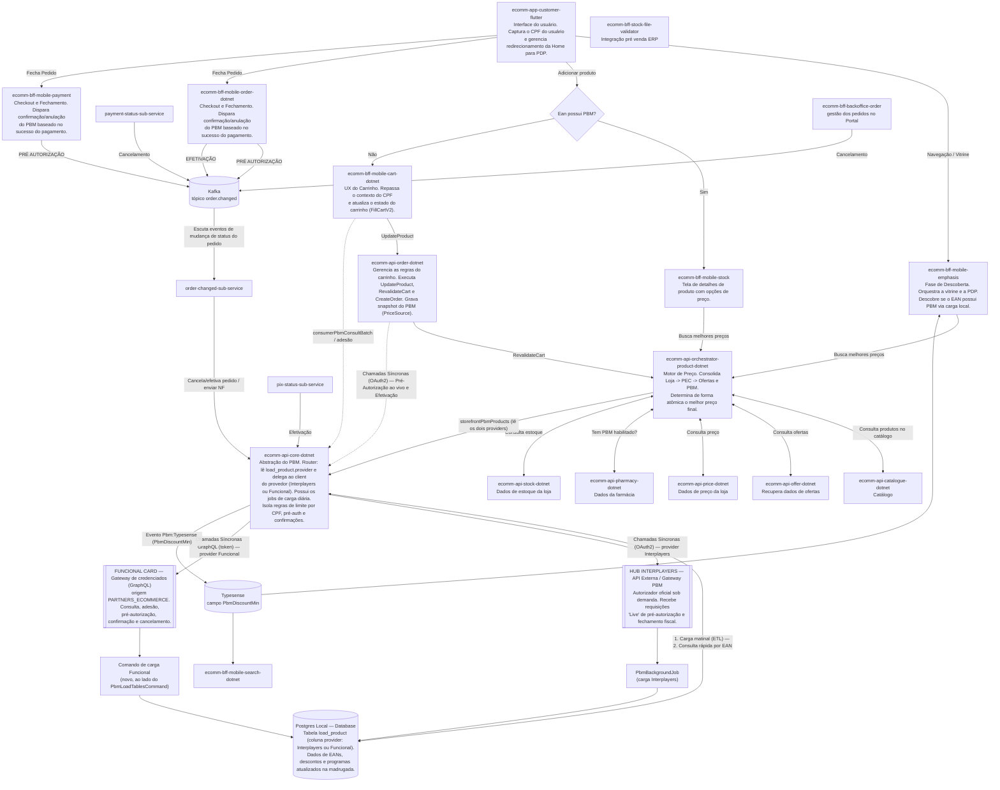

# Arquitetura de Desenvolvimento do PBM

**Fonte original:** diagrama de arquitetura fornecido pelo usuário (imagem) em 03/07/2026 — cobria só o provedor Interplayers.
**Atualização 29/10/2026:** incorpora a integração do provedor **Funcional Card**, conforme [`Integração Funcional/`](Integração%20Funcional/funcional-analise-tecnica.md) (análise técnica e material de negócio, 28/10/2026). A Interplayers já está em produção, em diversas lojas; a Funcional entra com **ajustes apenas na `ecomm-api-core-dotnet`**. App, BFFs (carrinho, vitrine, busca) e pedido permanecem no contrato de hoje.

---

## Diagrama

> **Nota sobre a leitura do diagrama:** o `ecomm-bff-stock-file-validator` aparece isolado, próximo à área do Kafka, sem uma seta explícita de conexão desenhada na imagem original — está listado na tabela de componentes abaixo por completude, mas sua relação exata com os demais componentes não está explícita no diagrama.
>
> **O que mudou em 29/10/2026 em relação ao diagrama original:** (1) a tabela local passa a se chamar `load_product` e ganha a coluna `provider`; (2) `ecomm-api-core-*` vira `ecomm-api-core-dotnet`, com o papel de router; (3) entra o gateway da Funcional como segundo provedor externo e o seu comando de carga; (4) o desconto chega à busca via evento Kafka `Pbm:Typesense` → Typesense (os BFFs de busca e destaque só leem o Typesense); (5) a consulta com CPF e a adesão passam pelo `consumerPbmConsultBatch` / `consumerPbmAdhesionForm`.

## Componentes

### App

| Componente | Descrição |
|---|---|
| `ecomm-app-customer-flutter` | Interface do usuário. Captura o CPF do usuário e gerencia redirecionamento da Home para PDP. **Não muda** com a Funcional. |

### BFF Mobile / Backoffice

| Componente | Descrição |
|---|---|
| `ecomm-bff-mobile-emphasis` | Fase de Descoberta. Orquestra a vitrine e a PDP. Descobre se o EAN possui PBM via carga local. Lê o desconto no Typesense (`PbmDiscountMin`); **não chama a core nem a Funcional**. |
| `ecomm-bff-mobile-search-dotnet` | Busca. Lê o desconto de laboratório no Typesense (`PbmDiscountMin`), como percentual. **Não muda.** |
| `ecomm-bff-mobile-stock` | Tela de detalhes de produto com opções de preço. |
| `ecomm-bff-mobile-cart-dotnet` | UX do Carrinho. Repassa o contexto do CPF e atualiza o estado do carrinho (FillCartV2). Continua em `consumerPbmConsultBatch`, `consumerPbmAdhesionForm` e `submitConsumerPbmAdhesion`. |
| `ecomm-bff-mobile-order-dotnet` | Checkout e Fechamento. Dispara confirmação/anulação do PBM baseado no sucesso do pagamento. |
| `ecomm-bff-mobile-payment` | Checkout e Fechamento. Dispara confirmação/anulação do PBM baseado no sucesso do pagamento. |
| `ecomm-bff-stock-file-validator` | Integração pré venda ERP. |
| `ecomm-bff-backoffice-order` | Gestão dos pedidos no Portal. |

### APIs de domínio (Catálogo / Preço / Pedido)

| Componente | Descrição |
|---|---|
| `ecomm-api-catalogue-dotnet` | Catálogo. |
| `ecomm-api-offer-dotnet` | Recupera dados de ofertas. |
| `ecomm-api-price-dotnet` | Dados de preço da loja. |
| `ecomm-api-pharmacy-dotnet` | Dados da farmácia. |
| `ecomm-api-stock-dotnet` | Dados de estoque da loja. |
| `ecomm-api-order-dotnet` | Gerencia as regras do carrinho. Executa `UpdateProduct`, `RevalidateCart` e `CreateOrder`. Grava snapshot do PBM (`PriceSource`). Continua em `fulfillPbmTransaction`, `confirmOrderPbmInvoice` e `cancelOrderPbmAuthorization`; **não ganha campo novo**. |
| `ecomm-api-orchestrator-product-dotnet` | Motor de Preço. Consolida Loja -> PEC -> Ofertas e PBM. Determina de forma atômica o melhor preço final. Continua na query `storefrontPbmProducts`, sem informar `provider`. |

### Domínio PBM

| Componente | Descrição |
|---|---|
| `ecomm-api-core-dotnet` | Abstração do PBM. **Único serviço alterado** para a Funcional. Expõe o contrato público em `POST /pbm/graphql` e, como **router**, lê `load_product.provider` e delega ao client do provedor (`IPbmProviderClient`, via factory `Get(PbmProvider)`). Possui os jobs de carga diária. Isola regras de limite por CPF, pré-auth e confirmações. |
| `pix-status-sub-service` | Sub-serviço que dispara o evento de **Efetivação** para a core a partir de mudanças de status de pagamento via PIX. |
| `payment-status-sub-service` | Sub-serviço que dispara evento de **Cancelamento** no tópico Kafka a partir de mudanças de status de pagamento. |
| `order-changed-sub-service` | Escuta eventos de mudança de status do pedido no tópico Kafka `order.changed` e aciona a core para cancelar/efetivar o pedido e enviar a NF. |
| `PbmBackgroundJob` / `PbmLoadTablesCommand` | Job (Hangfire) de carga (ETL) entre o HUB Interplayers e a base local. **Passa a copiar, apagar e publicar só as linhas `provider = Interplayers`** (backup e busca inclusive). |
| Comando de carga Funcional (novo) | Roda ao lado do `PbmLoadTablesCommand`. Chama `Pharma_discountPrograms` por CNPJ (`Pbm_Enabled`) e troca só `provider = Funcional` daquele CNPJ. Lista vazia ou HTTP ruim não apagam. Falha de um job não dispara o outro. |

### Infraestrutura

| Componente | Descrição |
|---|---|
| `Kafka` — tópico `order.changed` | Tópico de eventos de mudança de status do pedido (pré-autorização, efetivação, cancelamento). |
| `Kafka` — tópico `Pbm:Typesense` | Evento publicado pela core com o desconto por EAN (campo `PbmDiscountMin`). Mesmo evento para os dois provedores. |
| `Typesense` | Índice de busca. Recebe `PbmDiscountMin`; **o índice não ganha campo** com a Funcional. |
| `Postgres Local` (Database) | Tabela `load_product` (antes citada como `Carga_PBM`): EAN, `provider`, CNPJ, `program_id`, `program_name`, `discount_min`, `requires_crm`, `informative_message`. Atualizada na madrugada. Também guarda a sessão do pedido (`order_pbm`, com `transaction_code`, `attendance_hash`, `authorized_lines`). |

### Externo

| Componente | Descrição |
|---|---|
| `HUB INTERPLAYERS` (API Externa / Gateway PBM) | Autorizador oficial sob demanda. Recebe requisições "Live" de pré-autorização e fechamento fiscal. **Já em produção.** |
| `FUNCIONAL CARD` — Gateway de credenciados | API GraphQL. Produção: `https://stores.funcionalmais.com/graphql`; homologação: `https://stores-uat.funcionalmais.com/graphql` (segunda a sábado, 09h–23h). Autentica por `createToken` (cache de até ~24h). Origem fixa `PARTNERS_ECOMMERCE`. Options `Pbm:Funcional`: URL, login, timeout e `OptInOrigem`. Documentação do fornecedor em [`Documentação Funcional Card/`](Documentação%20Funcional%20Card/). |

## Seleção de provedor (router)

Hoje a api-core sobe com **um único** client de PBM (Interplayers). Registrar o da Funcional no mesmo lugar faria o da Interplayers deixar de valer; por isso o arranque passa a ter **os dois**, e cada operação pede o client do programa do produto.

- O provedor de cada EAN sai de `load_product.provider`. **EAN sem linha na base não chama nenhum provedor.**
- Um produto pertence a **um único programa** (esclarecimento do PO, 29/10/2026). Como proteção defensiva, EAN presente nos dois providers sai da vitrine e da busca, com log.
- Lote da consulta (`consumerPbmConsultBatch`) com **dois providers** falha antes do HTTP, com o erro que `PbmFulfillProviderResolver` já devolve.
- A efetiva (`FulfillPbmTransactionHandler`) já escolhe o programa antes da chamada e não escolhe de novo dentro do client.

## Fluxos principais

1. **Descoberta / Vitrine:** `ecomm-app-customer-flutter` navega para `ecomm-bff-mobile-emphasis`, que descobre se o EAN possui PBM via carga local e busca o melhor preço em `ecomm-api-orchestrator-product-dotnet`. O orchestrator chama `storefrontPbmProducts` na core, que **lê `load_product` (os dois providers) sem chamar o provedor externo**. A Funcional não tem endpoint de vitrine: o desconto vem da carga.
2. **Busca e destaque:** `ecomm-bff-mobile-search-dotnet` e `ecomm-bff-mobile-emphasis` leem o desconto no Typesense (`PbmDiscountMin`), que a core publica pelo evento `Pbm:Typesense` após a carga. Nenhuma chamada ao provedor.
3. **Adicionar produto / Consulta com CPF:** ao adicionar um produto, o app verifica "Ean possui PBM?" — se **Sim**, vai para `ecomm-bff-mobile-stock` (detalhes/opções de preço); se **Não**, vai direto para `ecomm-bff-mobile-cart-dotnet`. O carrinho chama `consumerPbmConsultBatch` na core. Provider Interplayers segue na consulta desconto; provider Funcional chama `Pharma_checkPricesAndRules` + `Pharma_verifyOptIn` (e `Pharma_assessEligibility` se a pessoa precisa de cadastro). Ver [`sequencia-pbm-ativar-desconto-cpf.md`](sequencia-pbm-ativar-desconto-cpf.md).
4. **Adesão (cadastro no programa):** `consumerPbmAdhesionForm` e `submitConsumerPbmAdhesion`, no mesmo BFF. Para a Funcional: `Pharma_assessEligibility`, texto do termo via `Pharma_retrieveTextTermsOptIn`, aceite via `Pharma_insertOptIn` e uma de três inscrições (`signUp`, `addProduct` ou `dependent`). Ver [`sequencia-pbm-adesao-funcional.md`](sequencia-pbm-adesao-funcional.md).
5. **Carrinho:** `ecomm-bff-mobile-cart-dotnet` aciona `UpdateProduct` em `ecomm-api-order-dotnet`, que por sua vez chama `RevalidateCart` no orquestrador de preço.
6. **Motor de preço:** `ecomm-api-orchestrator-product-dotnet` consolida dados de catálogo, ofertas, preço da loja, farmácia (elegibilidade PBM) e estoque, além do PBM lido da base local (`load_product`), carregada previamente pela core.
7. **Checkout / Fechamento:** ao fechar o pedido, `ecomm-bff-mobile-order-dotnet` e `ecomm-bff-mobile-payment` publicam eventos de **PRÉ AUTORIZAÇÃO** e **EFETIVAÇÃO** no Kafka (`order.changed`), e disparam confirmação/anulação do PBM conforme o sucesso do pagamento.
8. **Autorização/Efetivação PBM ao vivo:** `ecomm-api-order-dotnet` realiza chamadas síncronas (OAuth2) à core para pré-autorização e efetivação; a core repassa ao provedor do produto. Na Funcional: `Pharma_verifyOptIn` + `Sales_preAuthorizeSale` (reserva, válida até 30 dias) e, na nota, `Sales_confirmPreAuthorizedSale` (uma vez). Ver [`sequencia-pbm-efetivacao-funcional.md`](sequencia-pbm-efetivacao-funcional.md).
9. **Carga diária (ETL):** dois jobs independentes gravam em `load_product`, cada um só nas linhas do seu provider: o `PbmBackgroundJob`/`PbmLoadTablesCommand` (Interplayers) e o comando novo (Funcional, `Pharma_discountPrograms` por CNPJ). Não compartilham backup. Ver [`sequencia-pbm-carga-diaria.md`](sequencia-pbm-carga-diaria.md).
10. **Cancelamento/eventos assíncronos:** `payment-status-sub-service` e `ecomm-bff-backoffice-order` publicam eventos de **Cancelamento** no Kafka; o `order-changed-sub-service` escuta o tópico `order.changed` e aciona a core. **Funcional:** antes da nota não há chamada ao provedor (a sessão local sai e a reserva remota segue confirmável por até 30 dias); depois da nota, `Sales_cancel` com o `saleAuthorizationId`, sem janela de 7 dias. **Interplayers:** mantém o comportamento e a janela de 7 dias. Ver [`sequencia-pbm-cancelamento-funcional.md`](sequencia-pbm-cancelamento-funcional.md).

## Sessão do pedido (`order_pbm`) — campos usados pela Funcional

| Dado Funcional | Onde fica | Observação |
|---|---|---|
| `authorizationID` da reserva | `transaction_code` `varchar(64)` | Maior que 64: a efetiva falha. Não truncar. |
| `authorizationID` da confirmação | `saleAuthorizationId` em `authorized_lines` | Usado em `Sales_cancel`. |
| `createdAt` da reserva | `attendance_hash` `varchar(64)` | Vira `preAuthorizationDate`. |
| preço, quantidade, EAN | `authorized_lines` (JSON) | Nova coluna (migration em `OrderPbm.cs`); fora do GraphQL. A Interplayers continua só com EAN. |
| — | `order_pbm_industry.industry_company_code = 1` | Atalho para o cancelamento depois da nota; o id da Funcional não entra aqui. |

## Observabilidade e instabilidade

- Logs estruturados no Datadog, com `Provider=Funcional`; token e senha nunca entram. Alarmes: falha da carga (job, loja, lista apagada), falha de efetivação/confirmação, e sessão confirmada com chave de NF recusada.
- A Funcional usa client e comando de carga próprios; o client da Interplayers não tem circuit breaker e este trabalho não adiciona um. Com a Funcional instável, consulta/efetivação/confirmação/cancelamento falham, o carrinho bloqueia o adicionar e a efetivação **não** troca o preço para o cheio nem manda o produto para a Interplayers.
- **Em aberto (com o time técnico):** token em memória, ausência de circuit breaker e a chave de NF sem retry.

## Rollout

As farmácias são as de `Pbm_Enabled` (o SQL de `StorefrontPharmacyDirectory`); não há segunda lista. Antes da primeira carga Funcional em produção, o job da Interplayers precisa copiar, apagar e publicar só `provider = Interplayers`. Loja nova no rollout recebe a Funcional na carga seguinte.
