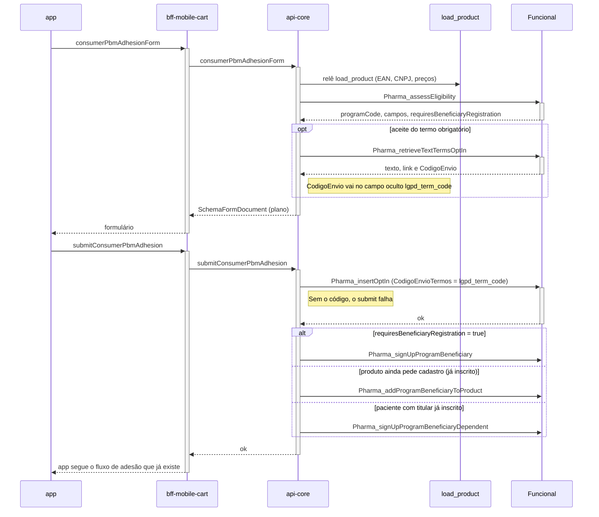

# PBM - Adesão (cadastro no programa) — Funcional (Sequência)

**Fonte:** [análise técnica da Funcional](Integração%20Funcional/funcional-analise-tecnica.md), seção 07 (28/10/2026). Documento criado em 29/10/2026.
**Referências do fornecedor:** [cadastro](Documentação%20Funcional%20Card/cadastro.md) e [OptIn](Documentação%20Funcional%20Card/OptIn.md).

---

## Diagrama

## Regras

- O app continua mostrando **o formulário que já sabe desenhar** (`SchemaFormDocument` plano). **Não há mudança de app nem de carrinho.**
- O handler relê `load_product` e chama `Pharma_assessEligibility` de novo; `programCode` é o de `eligibilityAssessment.programCode`. O `centralNumber` da resposta fica nulo.
- **Campos:** `HIDDEN` não aparece; `REQUIRED` e `OPTIONAL` seguem o `display`. Campo obrigatório aparece como obrigatório.
- **Termo (OptIn):**
  - `Pharma_verifyOptIn` não devolve o texto; o texto sai de `Pharma_retrieveTextTermsOptIn` (texto, link e `CodigoEnvio`).
  - Termo com texto aparece no formulário; termo só com link abre o link.
  - O `CodigoEnvio` vai em `lgpd_term_code` (campo oculto) e volta no aceite: o submit chama `Pharma_insertOptIn` com `CodigoEnvioTermos` e **só então** o cadastro.
  - O aceite na tela **não** chama `Pharma_sendOptInTerms`. O número `Origem` vem de `Pbm:Funcional:OptInOrigem`; o `5` do exemplo da Funcional não é default.
- **Três tipos de inscrição:**

| Situação | Mutation |
|---|---|
| Ainda não inscrito (`requiresBeneficiaryRegistration` verdadeiro) | `Pharma_signUpProgramBeneficiary` (`signUp`) |
| Já inscrito, só falta o produto | `Pharma_addProgramBeneficiaryToProduct` (`addProduct`) |
| Paciente com o titular já inscrito | `Pharma_signUpProgramBeneficiaryDependent` (`dependent`), no mesmo formulário plano |

- **`urlRegisterSite`** não monta formulário: na consulta, vira `WEBVIEW` (página do programa).
- **Pergunta-filha** (`extraFormFields.RelatedQuestions`) **não vira campo aninhado**: o formulário do app é plano. Segue o que a consulta já decidiu — página (se houver URL) ou bloqueio com a mensagem do programa. O exemplo de inscrição da Funcional manda essa pergunta no envio; aqui não.

Arquivos: `PbmAdhesionSchemaFormBuilder.cs` (ou builder Funcional no mesmo handler), `ConsumerPbmAdhesionFormHandler.cs`, `SubmitConsumerPbmAdhesionHandler.cs`. Teste: `FullyQualifiedName~FuncionalAdhesion`.

> **Relação com a Interplayers:** o fluxo de adesão da Interplayers (URL externa, e a evolução para adesão via API tratada em [ECA-630 — atualização](US/ECA-630-atualizacao-cadastro-via-api.md) e na [pendência de ficha técnica](Documentação%20Interplayers/PENDENCIA%20-%20Ficha%20Técnica%20Adesão%20via%20API.md)) é independente deste. A core escolhe o fluxo pelo provider do produto.
