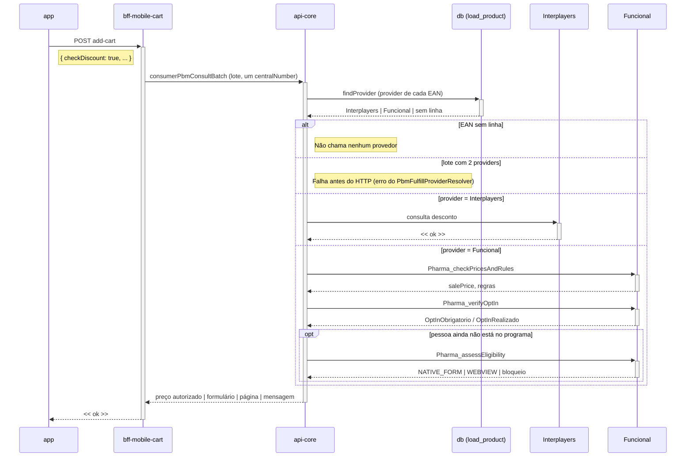

# PBM - Ativar desconto por CPF / Adicionar ao carrinho (Sequência)

**Fonte original:** diagrama de sequência fornecido pelo usuário (imagem, websequencediagrams.com).
**Atualização 29/10/2026:** incorpora a Funcional ([análise técnica](Integração%20Funcional/funcional-analise-tecnica.md), seção 06; [negócio](Integração%20Funcional/funcional-material-de-negocio.md), story 3).

---

## Diagrama

> **O que mudou:** o `POST check-discount` genérico virou `consumerPbmConsultBatch` (query no mesmo BFF), e o `findProvider` resolve entre dois provedores por EAN. Para a Funcional não existe uma única chamada "check-discount": a consulta combina preço, aceite do termo (OptIn) e elegibilidade. O contrato com o app e com o BFF **não muda**.

## Participantes

| Participante | Papel |
|---|---|
| `app` | Cliente mobile que adiciona o produto ao carrinho com `checkDiscount: true`. |
| `bff-mobile-cart` | BFF do carrinho (`ecomm-bff-mobile-cart-dotnet`). Chama a core em lote. |
| `api-core` | Abstração do domínio PBM. Resolve o provider de cada EAN e delega ao client certo. |
| `db` | `load_product`. Fonte do `provider` por EAN. |
| `Interplayers` | Provedor já em produção; segue na consulta desconto. |
| `Funcional` | Gateway de credenciados da Funcional. |

## Fluxo

1. `app` faz `POST add-cart` para `bff-mobile-cart` com `{ checkDiscount: true, ... }`.
2. `bff-mobile-cart` chama `consumerPbmConsultBatch` em `api-core` (um `centralNumber` para o lote).
3. `api-core` lê o provider de cada EAN em `load_product`. **EAN sem linha não chama a Funcional.** Um provider segue o client daquele hub; **dois providers no mesmo lote falham antes do HTTP**.
4. **Interplayers:** consulta desconto, inclusive com atendimento em aberto — como antes.
5. **Funcional:**
   1. `Pharma_checkPricesAndRules` (primeira perna da venda). `unitPriceCents` sai de `salePrice` em centavos, meio para longe de zero (52,99 → 5299). `funcionalPrice` e PMC não viram preço autorizado.
   2. `Pharma_verifyOptIn` (`origin: PARTNERS_ECOMMERCE`; o número `Origem` vem de `Pbm:Funcional:OptInOrigem` — config vazia falha a chamada; o `5` do exemplo da Funcional não é usado).
   3. `Pharma_assessEligibility` se a pessoa ainda não está no programa.
6. `api-core` responde ao BFF com o **preço autorizado**, o **formulário**, a **página** de cadastro ou a **mensagem** que bloqueia o item.

## Regras por resultado (Funcional)

| Situação | Resultado para a pessoa |
|---|---|
| CPF elegível | Item entra no carrinho com o preço autorizado. |
| Quantidade não autorizada | Desconto bloqueado. |
| Aceite do termo obrigatório e não feito (`OptInObrigatorio = S`, `OptInRealizado = N`) | Vê o texto ou o link do termo **antes** do desconto. |
| `OptInObrigatorio` e `OptInRealizado` ambos `N` | Esta compra segue; a mensagem de que a **próxima** exige o aceite volta para a pessoa. |
| Já aceito (`OptInRealizado = S`) | Segue. `verifyOptIn` repete antes da reserva. |
| Programa exige imagem de receita, dose diária sem dado no contrato ou `secondFactorAuthentication` diferente de `NONE` | Item não entra; a pessoa vê a mensagem. |
| Pessoa fora do programa (`requiresBeneficiaryRegistration`) | `NATIVE_FORM` (formulário do app) ou `WEBVIEW` com `embedUrl = urlRegisterSite`. `originPermitedRegister` falso usa a mesma página ou bloqueia se ela não existir. |
| Pergunta-filha obrigatória | Com URL, abre a página; sem URL, `canAddWithDiscount = false` e a mensagem do programa, **sem** `SchemaForm`. |
| Funcional indisponível | A chamada falha e o carrinho **bloqueia o adicionar**; o preço não volta para o cheio nem o produto vai para a Interplayers. |

`centralNumber` não vai no request nem volta no resultado; `conditions[]` fica vazio.

Arquivos: `PbmModuleSetup.cs`, `IPbmProviderClient.cs`, `UseCases/ConsultConsumer/`. Teste: `FullyQualifiedName~FuncionalConsult`.

> **Receita:** o fluxo de envio de receita do app já está em produção (ver [PRD de envio de receita](../Envio%20de%20receita/PRD-envio-receita-app.md)). Para a Funcional, o produto que exige receita fica marcado (`requires_crm`), mas a exigência **dentro da API da Funcional** (imagem anexada à venda) segue fora deste escopo: nesse caso o item não entra, com a mensagem do programa.
