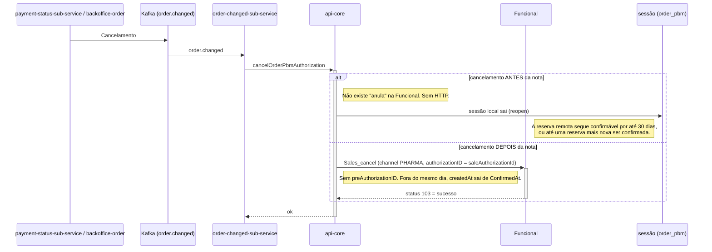

# PBM - Cancelamento — Funcional (Sequência)

**Fonte:** [análise técnica da Funcional](Integração%20Funcional/funcional-analise-tecnica.md), seções 03 e 08 (28/10/2026). Documento criado em 29/10/2026.
**Referência do fornecedor:** [Fluxo de venda — Cancelamento](Documentação%20Funcional%20Card/fluxo-venda.md).

---

## Diagrama

## Regras

| Momento | Funcional | Interplayers |
|---|---|---|
| **Antes da nota** | **Sem chamada** ao provedor. `AnulaPendingSessionAsync` retorna sucesso sem HTTP antes de montar o payload da Interplayers (que exige `tableId`). A sessão local sai; a reserva remota segue confirmável por até 30 dias, e só cai quando uma reserva posterior é confirmada. | Chama `/anula`, como hoje. |
| **Depois da nota** | **Um** `Sales_cancel` (`channel: PHARMA`) com `authorizationID` = `saleAuthorizationId`, **sem** `preAuthorizationID`. **Status 103 é sucesso.** Fora do mesmo dia, `createdAt` sai de `ConfirmedAt`. | Mantém o comportamento atual. |
| **Janela de 7 dias** | **Não se aplica**: compra Funcional confirmada há mais de sete dias ainda cancela. | Continua com a janela de 7 dias. |
| **Repetir o cancelamento** | Não gera erro novo. | — |

- `Sales_cancel` desfaz **venda confirmada**; não cancela pré-autorização.
- O provider vem do pedido, resolvido por `PbmFulfillProviderResolver` (a janela de 7 dias deixou de ser única).
- Se a Funcional está instável, a chamada falha (sem retry silencioso e sem troca para outro provedor).

Arquivos: `PbmFulfillProviderResolver.cs`, `CancelOrderPbmAuthorizationHandler.cs`. Teste: `FullyQualifiedName~FuncionalFulfill`.
