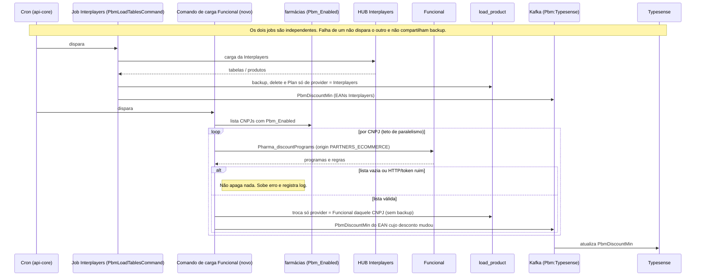

# PBM - Carga diária de produtos (Sequência)

**Fonte:** [análise técnica da Funcional](Integração%20Funcional/funcional-analise-tecnica.md), seções 02 e 04 (28/10/2026). Documento criado em 29/10/2026.
**Referência do fornecedor:** [Fluxo de venda — Processos diários de carga](Documentação%20Funcional%20Card/fluxo-venda.md).

---

## Diagrama

## Funcional — o que a carga faz

1. **Cron** da api-core dispara o comando novo, ao lado de `PbmLoadTablesCommand`.
2. A core lista as farmácias com **`Pbm_Enabled`** (o mesmo SQL de `StorefrontPharmacyDirectory`; não há segunda lista).
3. Para cada CNPJ, chama **`Pharma_discountPrograms`** com `origin: PARTNERS_ECOMMERCE` e `storeCode` = CNPJ. O token fica em memória, sem log (`createToken`, cache de ~24h). `CancellationToken` em toda chamada.
4. Grava em `load_product` **trocando só `provider = Funcional` daquele CNPJ** (método novo; o `ReplaceAsync` atual apaga a tabela inteira e exige `tableId`). **Lista vazia ou HTTP ruim não apaga.**
5. Publica na busca o EAN cujo desconto mudou, pelo mesmo evento de hoje (`Pbm:Typesense`, campo `PbmDiscountMin`). A carga reusa o `PbmTypesenseUpdatePlanner`.

### Mapeamento Funcional → `load_product`

Cada EAN de `rules.product.eans` vira uma linha; `state` e `city` ficam nulos (o escopo é o CNPJ da loja).

| Origem (Funcional) | Coluna | Regra |
|---|---|---|
| — | `provider` | `Funcional` |
| `rules.product.eans[]` | `ean` | `NormalizeEan`: 13 dígitos, zero à esquerda. Vazio não entra. |
| `storeCode` | `cnpj` | só dígitos |
| `id` / `name` | `program_id` `varchar(16)` / `program_name` `varchar(128)` | sem nome, id > 16 ou nome > 128: a linha não entra e o log guarda o id. **Não truncar.** |
| `saleBaseDiscountPercentage` | `discount_min` | percentual × 100, inteiro (10% → 1000; 10,5% → 1050, meio para longe de zero) |
| `requiresMedicalPrescription` | `requires_crm` | `true` quando a regra exige receita |
| `blocked` | — | a regra não entra |
| `allowedOrigins` sem a origem de e-commerce | — | o programa não entra |
| `rules[].description` | `informative_message` `varchar(512)` | > 512: a linha não entra. **Não truncar.** |
| `maximumConsumerPrice` | — | não entra (é PMC; `suggested_price_value` fica nulo; `suggested_price = N`) |

### Percentual na busca

`discount_min = 1000` → o planner publica 10 (`TryParseCentsAsReais` → o valor é lido como percentual pelos BFFs de busca e destaque). Publicar o `10` cru resultaria em 0,10. **10% aparece como 10% e 10,5% como 10,5%.** O índice do Typesense não ganha campo; busca e destaque não mudam.

## Interplayers — o que muda no job existente

Hoje o `ReplaceAsync` copia a **tabela inteira** para `load_product_backup`, apaga tudo e exige `tableId`; o `Plan` une a lista nova com esse backup. Com a Funcional na mesma tabela, isso apagaria as linhas dela e publicaria desconto vazio para os EANs só da Funcional.

**Ajuste obrigatório antes da primeira carga Funcional em produção:** o job da Interplayers passa a copiar, apagar e publicar **só `provider = Interplayers`** (backup e as duas listas do planner incluídos). Arquivos: `LoadProductWriter.cs`, `PbmTypesenseUpdatePlanner.cs`.

## Regras de proteção

| Situação | Resultado |
|---|---|
| Carga vazia da Funcional | Não apaga nenhum produto, nem da Interplayers. |
| Carga da Interplayers | Não apaga produto da Funcional nem tira o desconto dela da busca. |
| Falha de uma loja | Não apaga o que as outras já gravaram. |
| Loja que estourou o tempo | Não apaga a própria lista nem a das outras. |
| EAN nos dois providers *(defensivo — o PO confirmou que não ocorre no negócio)* | Não publica desconto no Typesense. |
| Produto bloqueado ou programa sem e-commerce | Não entra. |

## Observabilidade

Um log por loja e um do job, com CNPJ, linhas gravadas, linhas recusadas e duração, sempre com `Provider=Funcional`. Alarme se o job falha, se termina sem loja, ou se uma loja com erro teve a lista apagada.

Teste: `dotnet test tests/Pbm/Units/Pbm.Units.csproj --filter FullyQualifiedName~FuncionalLoad`.
