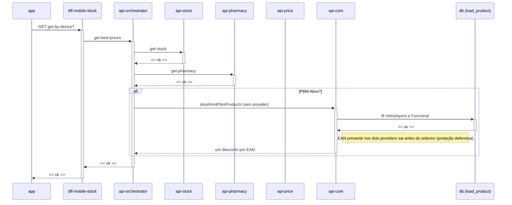

# PBM - Vitrine de produtos (Sequência)

**Fonte original:** diagrama de sequência fornecido pelo usuário (imagem, websequencediagrams.com).
**Atualização 29/10/2026:** incorpora a Funcional ([análise técnica](Integração%20Funcional/funcional-analise-tecnica.md), seções 02, 04 e 05).

---

## Diagrama

> **Nota sobre a leitura do diagrama:** `api-price` aparece como participante no cabeçalho da imagem original, mas não possui nenhuma seta de interação desenhada — está listado na tabela abaixo por completude.
>
> **O que mudou:** a operação passou a se chamar `storefrontPbmProducts` (antes `get-pbm-products` / `findPBMProducts`) e **não informa `provider`**; a core lê os dois providers de `load_product`. **Nenhuma chamada ao provedor externo** acontece na vitrine: a Funcional não tem endpoint de vitrine, o desconto vem da carga diária.

## Participantes

| Participante | Papel |
|---|---|
| `app` | Cliente mobile que solicita a vitrine de produtos por dispositivo. |
| `bff-mobile-stock` | BFF que orquestra a chamada de melhores preços para a vitrine. |
| `api-orchestrator` | Motor de preço. Consolida estoque, farmácia e produtos PBM. |
| `api-stock` | Fornece dados de estoque da loja. |
| `api-pharmacy` | Fornece dados da farmácia (elegibilidade). |
| `api-price` | Presente no diagrama original sem interação explícita. |
| `api-core` | Abstração do domínio PBM. Em `storefrontPbmProducts`, lê `load_product` (Interplayers e Funcional) e devolve um desconto por EAN. |
| `db` | Tabela `load_product` (coluna `provider`), carregada na madrugada. |

## Fluxo

1. `app` faz `GET get-by-device?` para `bff-mobile-stock`.
2. `bff-mobile-stock` solicita `get-best-prices` a `api-orchestrator`.
3. `api-orchestrator` consulta `get-stock` em `api-stock` e `get-pharmacy` em `api-pharmacy`, recebendo `<< ok >>` de ambos.
4. **Se PBM Ativo:** `api-orchestrator` chama `storefrontPbmProducts` em `api-core`, **sem informar `provider`**. A core lê `load_product` com os dois providers. Como a linha de CNPJ da Funcional ganharia da linha nacional da Interplayers no `SelectBestPerEan`, um EAN presente nos dois providers sai antes do selector, com log, e não volta na query (proteção defensiva — o PO confirmou que um produto pertence a um único programa).
5. `api-core` devolve **um desconto por EAN**, sem chamar a Funcional nem a Interplayers.
6. `api-orchestrator` responde `<< ok >>` a `bff-mobile-stock`, que responde `<< ok >>` ao `app`.

## Regras

- O app mostra o desconto de laboratório também para produto da Funcional, sem tela nova e sem campo de programa.
- Busca e destaque não passam por este fluxo: leem o desconto no Typesense (`PbmDiscountMin`), publicado pela core após a carga. Ver [`sequencia-pbm-carga-diaria.md`](sequencia-pbm-carga-diaria.md).
- O input GraphQL de `storefrontPbmProducts` não ganha campo.
- Arquivos: `StorefrontPbmProductsHandler.cs`, `LoadProductReader.cs`. Teste: `FullyQualifiedName~StorefrontFuncional`.
